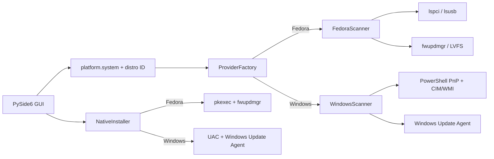

# DriverDesk

PoC desktop Python/PySide6 per rilevare dispositivi e indirizzare gli aggiornamenti ai canali nativi di Fedora Linux e Windows 10/11.

## Avvio

```bash
python -m pip install -r requirements.txt
python driverdesk.py
```

Su Fedora sono usati `pciutils` (`lspci`), `usbutils` (`lsusb`) e `fwupd`/LVFS quando installati. Su Windows lo scanner usa PowerShell, `Get-PnpDevice`, `Win32_PnPSignedDriver` via CIM/WMI e Windows Update Agent COM. Gli update Windows trovati possono essere selezionati, scaricati e installati nell'app tramite WUA; l'installazione richiede UAC. Non sempre il catalogo espone un'associazione affidabile con un singolo ID PnP.

I test indipendenti dai privilegi e dall'hardware si eseguono con `python -m unittest discover -s tests`.

## Schema architetturale



`AbstractDriverScanner` e `AbstractDriverInstaller` sono contratti condivisi. `ProviderFactory` seleziona le implementazioni a runtime senza configurazione manuale. Scansione e installazione girano in `QThread`; la GUI non si blocca durante le interrogazioni. Il backend Fedora identifica dispositivi PCI/USB e installa il firmware selezionato da LVFS tramite fwupd/Polkit. Windows raccoglie identificativi PnP, stato e versione firmata, interroga Windows Update Agent e ne usa le API di download e installazione con consenso UAC.

La colonna esito usa il semaforo: **rosso** per update obbligatori/critici o dispositivi con driver mancante/in errore; **giallo** per update disponibili o casi da verificare; **verde** per dispositivi rilevati senza problemi noti. Gli update selezionati sono confermati prima dell'installazione e le fasi di download/installazione vengono mostrate nella barra di stato.

## Permessi, sicurezza e limiti del PoC

- La scansione è read-only e non richiede privilegi amministrativi. Alcuni dettagli hardware possono non essere disponibili con permessi utente.
- Fedora: gli update firmware selezionati vengono installati dentro l'app con `fwupdmgr update ID`; per i driver PCI caricati, il prototipo risale dal modulo al file e al pacchetto proprietario (`modinfo`/`rpm -qf`), interroga DNF5 e installa solo i pacchetti selezionati con `dnf5 upgrade --refresh --assumeyes`, elevato tramite `pkexec`. Gli aggiornamenti kernel possono richiedere un riavvio. Dispositivi o driver senza associazione univoca a un RPM non vengono aggiornati automaticamente.
- Windows: l'app interroga Windows Update Agent, poi scarica e installa solo gli update driver selezionati tramite le API WUA. Windows mostra la richiesta UAC; policy aziendali o privilegi insufficienti possono impedire l'operazione. Non vengono eseguiti installer di terze parti.
- Gli ID e le versioni vengono mostrati quando l'interfaccia nativa li rende disponibili. `lspci`/`lsusb` non forniscono sempre una versione driver; Linux spesso carica un modulo incluso nel kernel invece di un driver per dispositivo.
- È un prototipo: per un prodotto distribuibile servono test su hardware reale, firma e packaging specifici per OS, gestione più dettagliata degli errori/rollback e verifica delle API disponibili sulle versioni target.